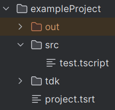

# How to setup a Tscript-Project

In this section is shown how you can set up a new tscript project.
An example project can be found in `exampleProject`.


### The project structure

It is recommended to structure your project as follows:<p>
<br>

- <b>exampleProject:</b> The overall project directory. Every
file concerning the project should be stored here.
- <b>project.tsrt:</b> This Project file defines the overall
configuration for execution and dependency loading.
- <b>src:</b> the source folder for the actual script files
to execute. Here the main script is the `test.tscript` file.
- <b>tdk:</b> the <b>Tscript development kit</b> defines a set
of commonly used code snippets. This includes features like threading,
math namespaces, canvas- and turtle namespaces, access to java classes, etc.
- <b>out:</b> This directory is optional and may be generated on execution
automatically. In this directory all compiled files are stored for the execution
process.


### The Project File

The Project File defines the execution configuration. It specifies source locations,
the output location (the location of compiled files), etc.
Every line contains one command followed by a single argument, separated by a space.
<p>
Note that the <b>required</b> importance
states that the command is only required for direct execution. When included (see `package`) the file is still valid,
even without these commands.

| Command    | Argument                                               | Importance | Description                                                                                                                                                                       |
|------------|:-------------------------------------------------------|:-----------|:----------------------------------------------------------------------------------------------------------------------------------------------------------------------------------|
| src        | source directory                                       | required   | Defines a directory with the actual source code. All `.tscript` files in it (including subdirectories) are compiled. May be given multiple times for different directories.       |
| out        | output directory                                       | required   | Defines the directory where compiled files are stored for execution. It is cleared and refilled on every run and is automatically used as a root path.                          |
| run        | boot module                                            | required   | Defines the module being executed on program start. This is the name declared with `module <name>;`, not the file name.                                                           |
| inspection | inspection directory                                   | optional   | Defines the directory where inspection files are stored. Inspection files contain the bytecode in a human readable format. It might be useful for debugging.                     |
| root       | additional root directory                              | optional   | Defines an additional root path. A root path defines a directory where the Virtual Machine looks up imported modules. May be given multiple times.                               |
| package    | included directory                                     | optional   | Includes a directory (for example the tdk). All `.tsrt` files in it are included (their native functions are registered) and all directories containing `.tscript` files are compiled as additional source directories. The tdk must be included explicitly. |
| native     | fully qualified name of native function implementation | optional   | Registers the implementation of a native function (see [native functions](writing_native_functions.md)). <b>There cannot be multiple native functions with the same name, even across inclusions!</b> |
| jit        | `on` or `off`                                          | optional   | Enables or disables the [JIT compiler](../docs/jit_compiler.md). The JIT is enabled by default.                                                                                 |

Relative paths are resolved against the current working directory, not against the location of the project file.
Compiled files are stored flat in the output directory (named after the source file), so
source files in different directories must have different file names.

The project file of the example project:
```
src exampleProject/src
out exampleProject/out
inspection exampleProject/out/inspect

run test

package exampleProject/tdk

jit on
```


### Running a Project

From the repository root, the example project can be run with Gradle:
```shell
./gradlew run --args="-p exampleProject/project.tsrt"
```

The command line runtime (`com.tscript.cli.tscript`) supports the following options:

| Option            | Description                                                                         |
|-------------------|-------------------------------------------------------------------------------------|
| `-p`, `--project` | the project file to execute                                                         |
| `-m`, `--module`  | runs an already compiled module instead of a project file (no native functions)     |
| `-r`, `--root`    | the root directory used with `-m` (default: the working directory)                  |
| `-d`, `--debug`   | runs with the command line debugger attached (see [debuggers](writing_debuggers.md)) |

Source files can also be compiled without running them with the compiler `com.tscript.cli.tscriptc`
(`-f <file or directory>`, `-o <output directory>`, `-i` to write inspection files instead).

From Java code a project is run with:
```java
ProjectFile projectFile = ProjectFile.parse("./exampleProject/project.tsrt");
int exitCode = ProjectFileRunner.runTscriptProject(projectFile);
```
